# Using cnpy

cnpy is a Chinese pinyin spaced-repetition app. This guide describes the quiz workflow and the dictionary, note-taking, text-analysis, and statistics tools.

## Reading quiz {#reading-quiz}

Start with a batch of 20 vocabulary items. Once the batch has been surpassed, start another. After each round of answers that are not **Right**, cnpy repeats the missed items until they are all right. If there are 10 wrong answers, a repeat drill starts earlier.

The quiz does not check for typos and does not turn an answer into Right or Wrong automatically. Use **Not Sure** when you are uncertain.

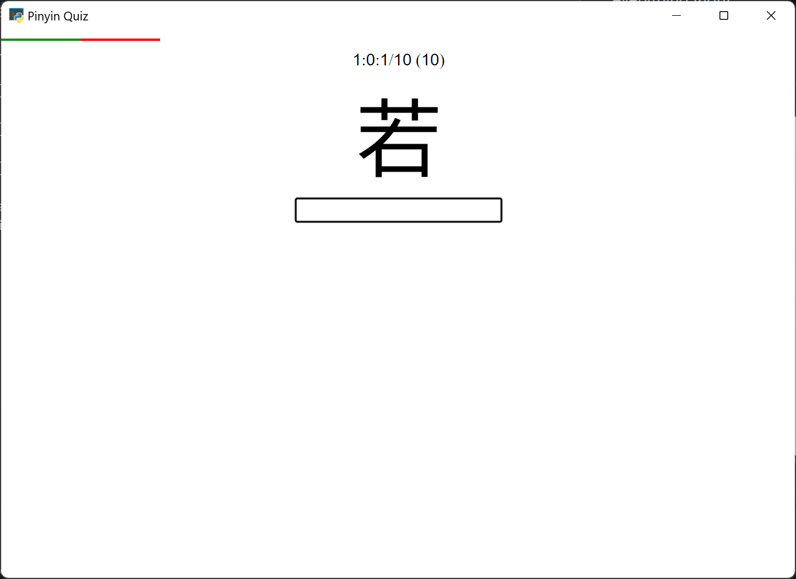

### Keyboard shortcuts and answers

- `v` is accepted for `u:` or `ü`, which is useful when practicing with an input method.
- `Esc` selects **Not Sure**.
- `Ctrl+Z` undoes an answer; the item moves to the end of the queue and can be answered again.
- `F1` skips the current vocabulary. Adding it to the permanent skip list is a separate action.
- `F4` ends the current batch and starts a wrong-answer drill or a new batch.
- Use `F1` and `F4` before answering, not as a way to reveal an answer.
- When a word has multiple valid readings, enter them separated by semicolons. Whitespace is ignored. Important readings can be required; uncommon readings can be disabled and counted wrong.
- Custom vocabulary can be added to the end of the due queue when it exists in CC-CEDICT.
- Vocabulary can be permanently skipped if it was added accidentally or is considered uncommon.

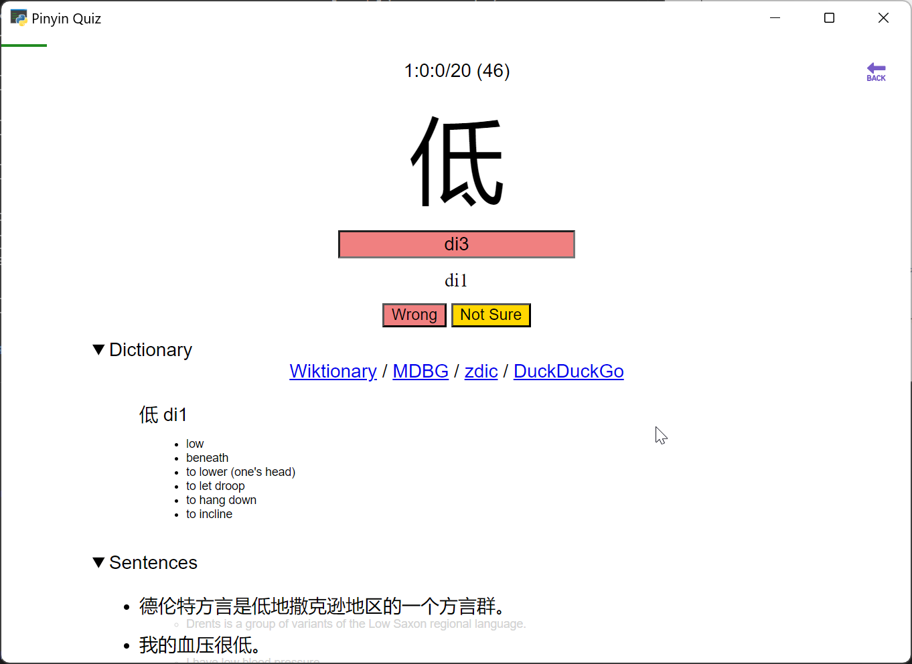

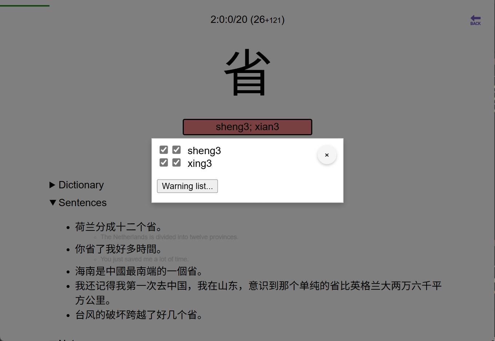

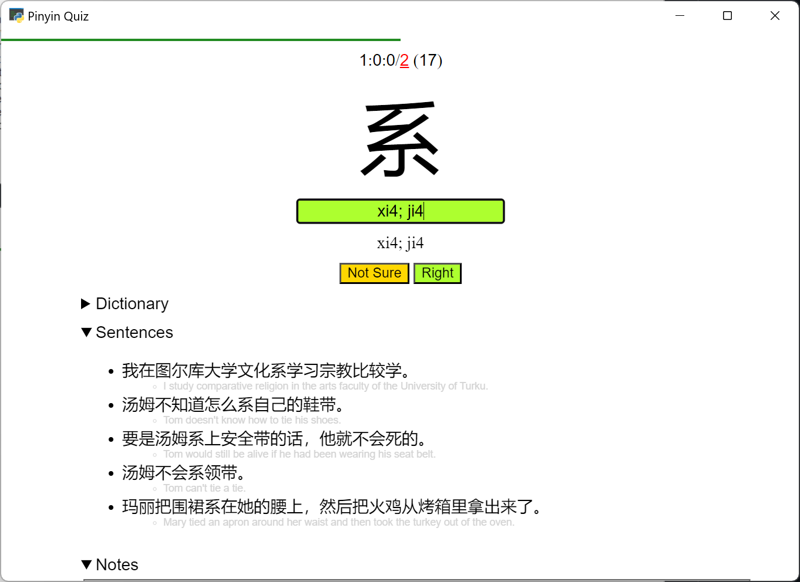

## Meanings and notes {#meanings-and-notes}

The optional meaning quiz is AI-generated and does not count toward the spaced-repetition score. It requires an LLM API key. The context menu provides access to its review log.

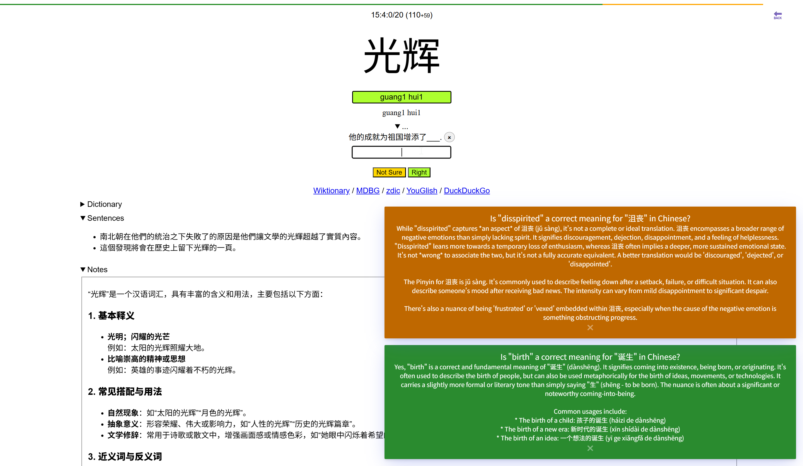

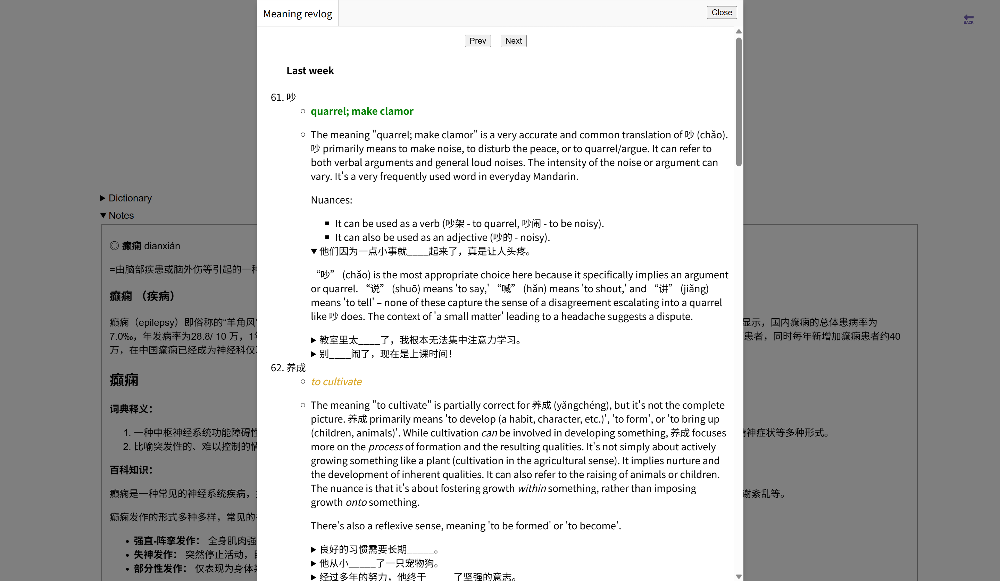

Notes use Markdown with bidirectional conversion through [Showdown](https://showdownjs.com/). You can paste content from dictionary websites. An optional AI dictionary can help with monolingual definitions, colloquial usages, and grammar explanations.

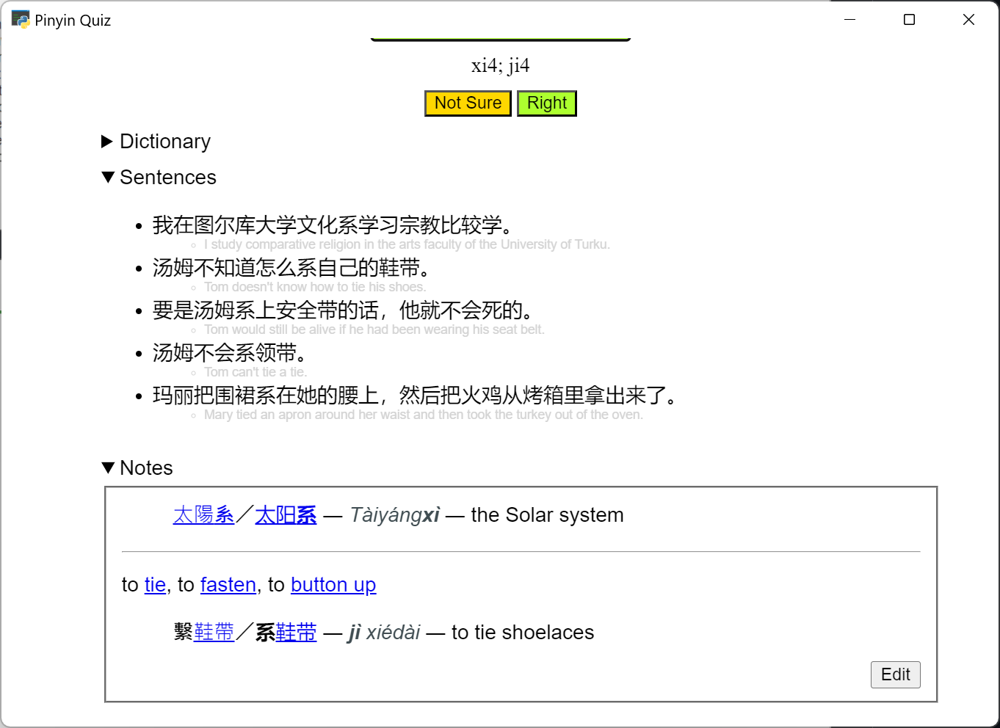

## Hanzi and text tools {#hanzi-and-text-tools}

Right-click a character or word to find similar Hanzi and vocabulary. The context menu also provides text-to-speech, additional actions, and CC-CEDICT updates.

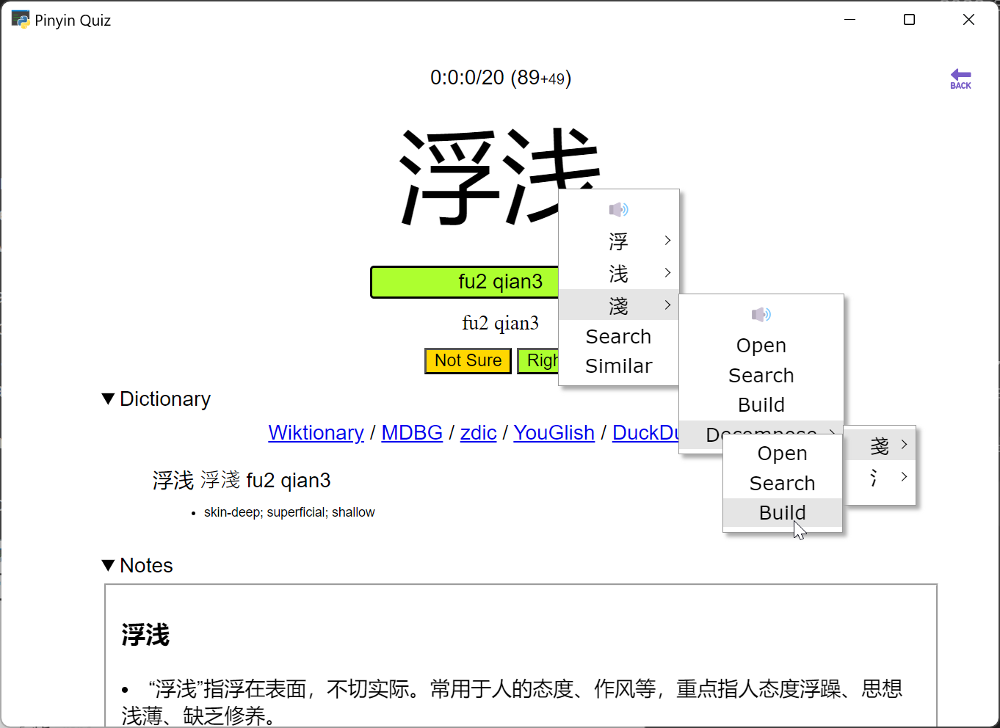

The search bar supports regular expressions, including searches for characters or words contained in other vocabulary. Quiz history is also available.

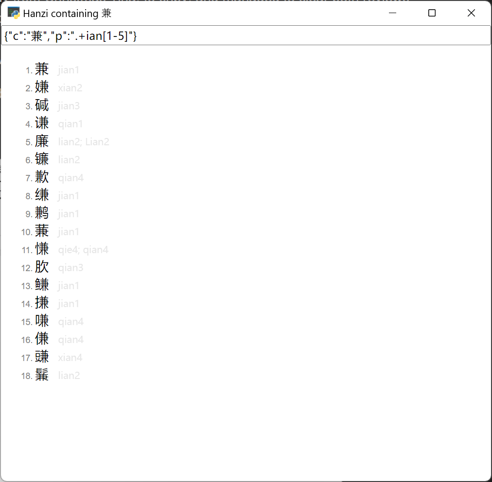

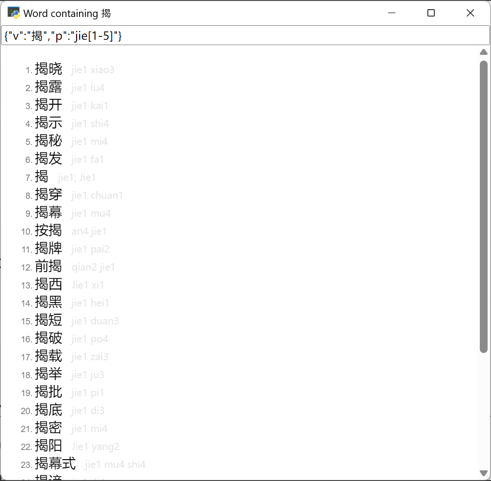

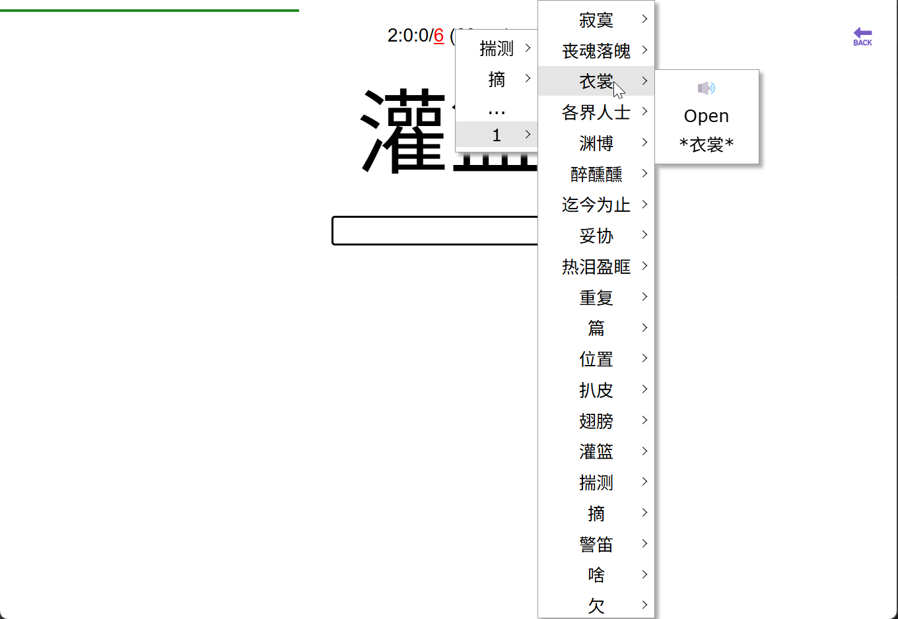

### Text analysis

Parse native Chinese articles and optionally add new vocabulary to a list. New Hanzi and names can be filtered, and vocabulary already quizzed is excluded from the results.

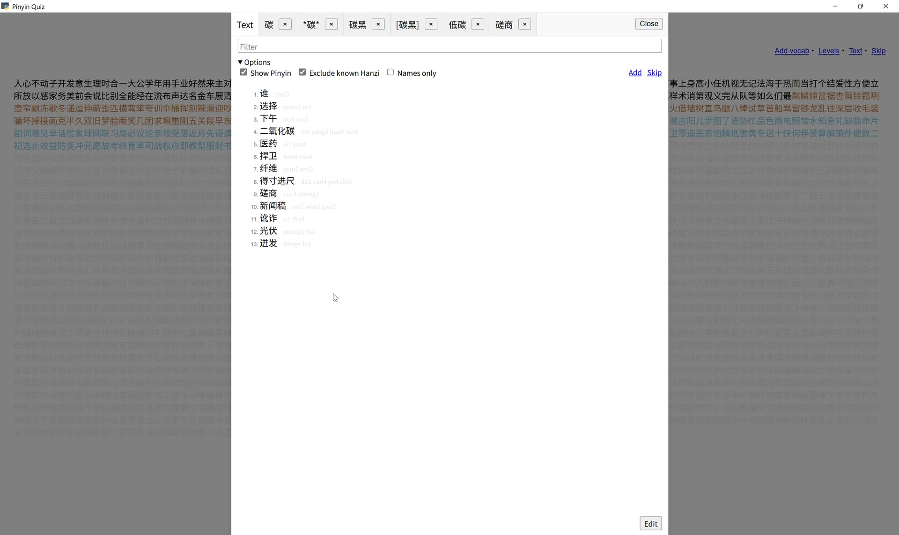

## Vocabulary levels

The app's 60 vocabulary levels come from the [ZhQuiz project](https://github.com/zhquiz/level), based on HSK 1–6 and ordered with common Hanzi first:

| HSK | Levels |
| --- | --- |
| HSK 1 | 1–5 |
| HSK 2 | 6–10 |
| HSK 3 | 11–20 |
| HSK 4 | 21–30 |
| HSK 5 | 31–40 |
| HSK 6 | 41–60 |

[Browse the vocabulary levels](/levels/).

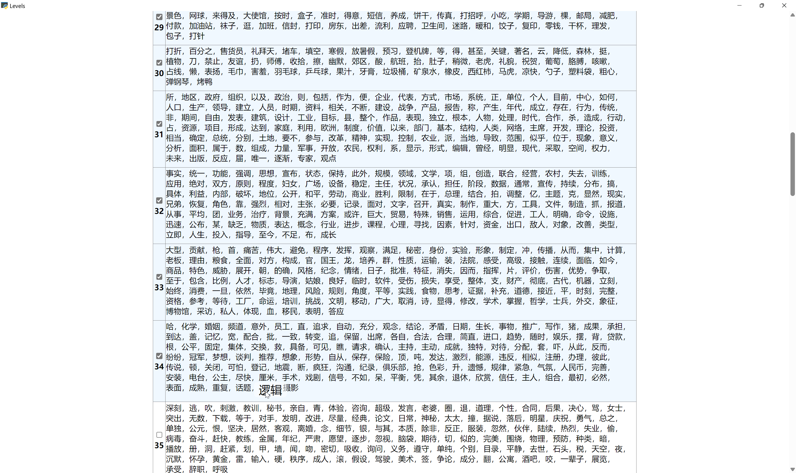

## Statistics and settings {#statistics-and-settings}

cnpy counts a vocabulary item as learned when its FSRS `difficulty` is below 6. Accuracy is calculated as `learned / started × 100%`.

Hanzi learned is calculated using these criteria:

1. Used in at least five vocabulary items.
2. Learned as a vocabulary item with a lone or repeated Hanzi.
3. Used in at least three vocabulary items.

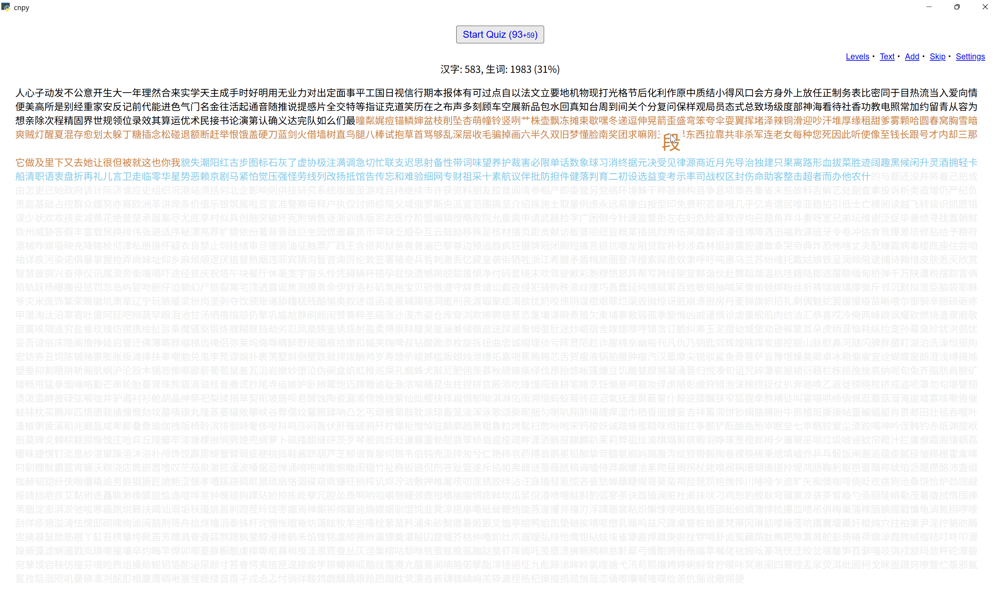

AI dictionary and text-to-speech settings are available from the dashboard. Other configuration notes:

- Disable **New items per session** to finish reviews before adding new vocabulary.
- [EmotiVoice](https://github.com/netease-youdao/EmotiVoice?tab=readme-ov-file#quickstart) can be used instead of [gTTS](https://github.com/pndurette/gTTS?tab=readme-ov-file#disclaimer).
- LLM API keys and model names are available from [DeepSeek](https://api-docs.deepseek.com/), [OpenAI](https://platform.openai.com/docs/models), and [Google AI Studio](https://aistudio.google.com/). These services may be paid.
- Install [Ollama](https://ollama.com/) to use an offline LLM.
- The sync database can be copied to a chosen location, such as Google Drive or Dropbox.

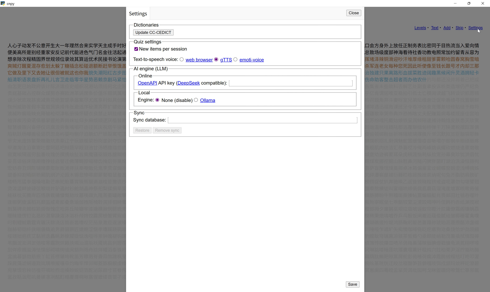

## Data sources {#data-sources}

- Vocabulary and dictionary entries: [CC-CEDICT](https://www.mdbg.net/chinese/dictionary?page=cc-cedict), published by MDBG under [CC BY-SA 4.0](https://creativecommons.org/licenses/by-sa/4.0/).
- Example sentences: [Tatoeba](https://tatoeba.org/). Each example in the vocabulary lessons links to its Tatoeba sentence page for attribution and license details. Tatoeba's default license for text sentences is [CC BY 2.0 FR](https://creativecommons.org/licenses/by/2.0/fr/).
- Hanzi decomposition: [CJKV Ideograph Database](https://github.com/cjkvi/cjkvi-ids).
